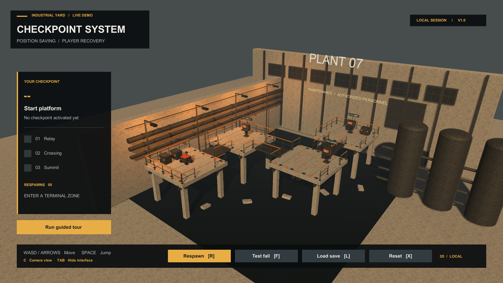
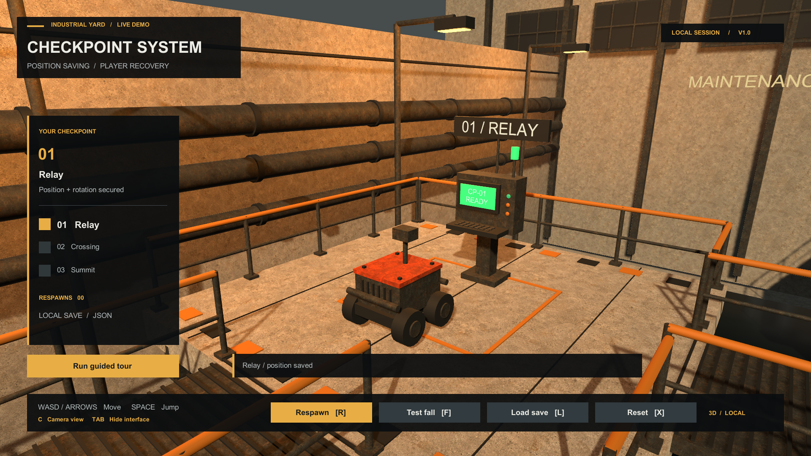
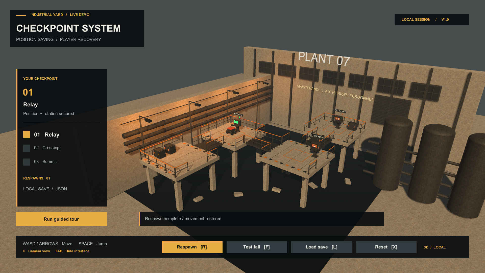
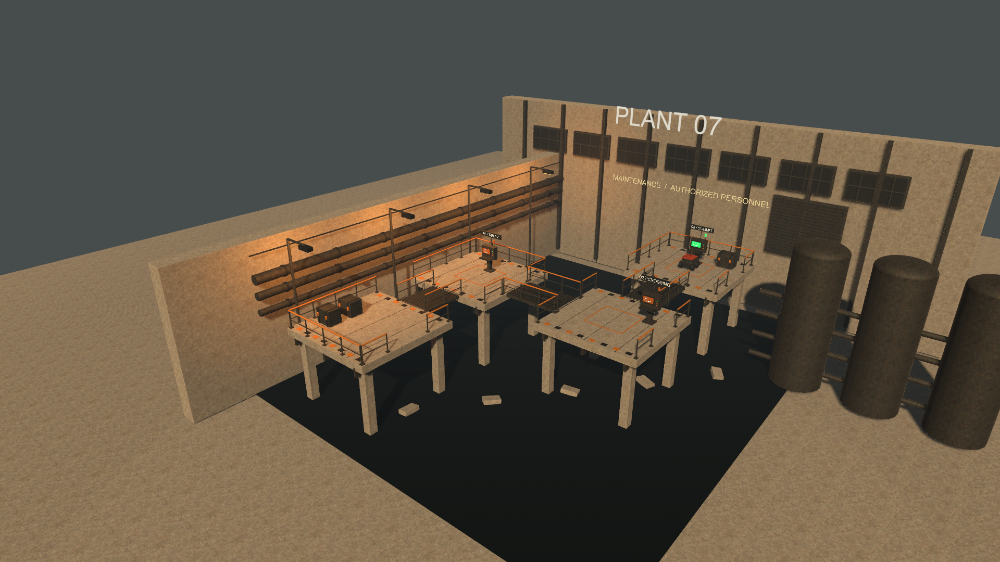

# Checkpoint System

A free checkpoint and respawn asset for Unity 3D games. Save a checkpoint's spawn position and rotation, return the player there after a fall or death, and restore progress from a local JSON file.

**Version 1.0.0 · Unity 2022.3 LTS · Built-in Render Pipeline · MIT**



[User manual](Assets/Checkpoint%20System/Documentation/Manual.md) · [PDF manual](Assets/Checkpoint%20System/Documentation/Checkpoint-System-Manual.pdf) · [Screenshots](Media) · [License](LICENSE.txt)

## Included

- Checkpoints that save world-space position and rotation.
- CharacterController teleporting and Rigidbody velocity reset.
- Configurable respawn delay, movement-script suspension and UnityEvents.
- Local JSON storage with separate scene keys and save slots, validation and backup recovery.
- Optional activation in increasing checkpoint order.
- Hazard triggers and minimum-height recovery.
- Four prefabs and an industrial scene with three checkpoints, player controls and a guided tour.
- Editable C# source and English documentation in MD, TXT and PDF.

## Run the project

1. Download and extract this repository, or clone it.
2. In Unity Hub, add the folder containing `Assets`, `Packages` and `ProjectSettings`.
3. Open it with **Unity 2022.3.62f3**.
4. Select **Tools > Checkpoint System > Open Demo Scene**.
5. Press **Play**. Select **Run guided tour**, or move into a checkpoint and press **F** to test fall recovery.

The project uses the Built-in Render Pipeline and the legacy Input Manager. No external runtime packages are required.

### Add the asset to an existing project

Copy `Assets/Checkpoint System` and its adjacent `Checkpoint System.meta` into your project's `Assets` folder. Keep the `.meta` files inside the asset so its scene, prefabs and materials retain their references. The included `LICENSE.txt` stays with the asset.

Keep your existing project's `Packages` and `ProjectSettings` folders. The settings in this repository configure the standalone example project.

## Controls

| Input | Action |
| --- | --- |
| WASD / arrow keys | Move |
| Space | Jump |
| R | Respawn at the current checkpoint |
| F | Fall into the recovery zone |
| L | Load saved progress |
| X | Clear the current scene and slot |
| C | Switch camera view |
| Tab | Show or hide the interface |

The guided tour clears the example's save slot before starting. The scene uses key `checkpoint-showcase-v1` and slot `showcase-player`.

## Use with your player

1. Add `RespawnTarget` to the player root that owns its CharacterController or Rigidbody.
2. Add a `CheckpointManager` and assign its **Player** field.
3. Place the **Checkpoint Beacon** prefab and position its **Spawn Point** above solid ground.
4. Give each checkpoint a unique ID. After duplicating a checkpoint, use **Generate New Checkpoint ID** in its component menu.
5. Call `RequestRespawn()` from your health or damage system, or use the **Respawn Zone** prefab.

```csharp
using CheckpointSystem;
using UnityEngine;

public sealed class PlayerRecovery : MonoBehaviour
{
    [SerializeField] private CheckpointManager checkpoints;

    public void OnDeath()
    {
        if (checkpoints != null)
            checkpoints.RequestRespawn();
    }
}
```

Assign the manager in the Inspector. Use **Suspend During Respawn** to pause selected movement or camera behaviours during the delay. If your controller keeps its own velocity or grounded state, reset it through `RespawnTarget.OnTeleported`.

The [manual](Assets/Checkpoint%20System/Documentation/Manual.md) covers configuration, storage, events, the API and troubleshooting.

## Saving and recovery

The default store writes JSON under `Application.persistentDataPath/CheckpointSystem`. Progress is scoped to a scene key and save slot. Automatic saving and startup restoration can be configured on the manager; explicit save and load methods are also available.

Before the first checkpoint, respawn returns to the initial pose. The delay uses unscaled time. Spawn positions are stored in world space, so they do not follow moving platforms or later level edits.

## Screenshots

### Checkpoint activated



### Respawn completed



### Industrial scene



All eight images in [Media](Media) are unaltered captures from the running Unity player at 1920 × 1080.

## Repository layout

```text
Assets/Checkpoint System/
  Art/             Materials, textures and shader
  Documentation/   English manual in MD, TXT and PDF
  Prefabs/         Four reusable prefabs
  Scenes/          Configured industrial scene
  Scripts/
    Runtime/       Checkpoints, respawn and storage
    Scene/         Player movement, indicators and interface
    Editor/        Scene validation and menu commands
  LICENSE.txt
Media/             Gameplay screenshots
Packages/          Unity built-in module dependencies
ProjectSettings/   Standalone project configuration
```

## Compatibility

Tested with **Unity 2022.3.62f3 on Windows**, using the **Built-in Render Pipeline**. The included materials and shader need conversion or replacement for URP/HDRP. Other operating systems, Unity 6 and new-Input-System-only controls have not been independently tested.

The asset handles local 3D checkpoint progress within one scene. Multiplayer, 2D physics, cross-scene loading, inventory storage, cloud saves and automatic safe-ground searches are outside its scope.

## License

The code and included asset files are provided under the [MIT License](LICENSE.txt). Keep the copyright and permission notice when redistributing them.

Unity built-in resources are supplied by Unity. See the [dependency notices](Assets/Checkpoint%20System/Documentation/Third-Party%20Notices.txt).
